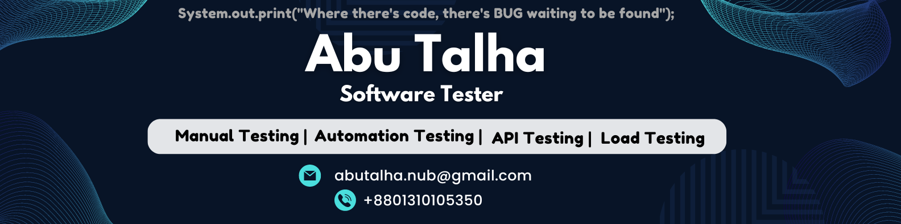

# Md. Abu Talha

### Software QA & Automation Engineer | SDET

**Playwright · Python · Selenium · API Testing · CI/CD**

Building reliable software through structured testing, automation engineering, and quality-focused problem solving.

  
  
  
  

---

## 👨‍💻 Professional Summary

I am a **Software QA & Automation Engineer** with professional experience in SaaS, FinTech, ERP, FMCG, and Web & Mobile Applications.

My focus is on ensuring software quality through structured test design, functional and regression testing, API validation, database verification, and test automation.

I work with modern automation technologies, including **Playwright with Python, Selenium with Java, and API testing tools**, while continuously developing my expertise in scalable automation frameworks and CI/CD integration.

### Core Competencies

- Designing maintainable and reusable automation frameworks.
- Building reliable UI and API automation solutions.
- Validating complex business workflows and database operations.
- Improving software quality through risk-based testing.
- Integrating automated tests into CI/CD pipelines.
- Performing performance and application security testing.

**Professional Interests:** QA Automation Engineer · SDET · Software Quality Engineering

---

## 🧰 Technical Skills & Tools

### Programming Languages

  
  
  
  

### UI Automation Testing

  
  
  
  
  

### API Testing

  
  
  

### Performance & Mobile Testing

  
  
  
  

### Database & Reporting

  
  
  

### DevOps, CI/CD & Version Control

  
  
  
  

### Security Testing

  
  
  
  

### Project Management & Development Tools

  
  
  
  

---

## 🏢 Professional Experience

### Software QA Engineer — Suffix IT Limited

**August 2025 – Present** | On-site | Dhaka, Bangladesh

**Industry:** ERP, FMCG, Manufacturing & Enterprise Business Applications

**Project Domain:** Enterprise Sales & Distribution, Marketing SaaS, ERP and Mobile Applications.

**Client:** Abul Khair Group (FMCG / Manufacturing)

**Key Responsibilities:**

- Perform functional, regression, smoke, and sanity testing of enterprise business applications.
- Validate end-to-end business workflows across ERP, web portals, and mobile applications.
- Execute API testing and verify request/response behavior.
- Perform SQL-based database validation and data integrity checks.
- Identify, document, track, and verify software defects.
- Collaborate with developers, business analysts, and stakeholders to improve product quality.
- Support test automation activities and quality assurance processes.

### Associate QA Engineer — Hishabee Technologies Limited

**October 2024 – July 2025** | On-site | Dhaka, Bangladesh

**Industry:** SaaS, FinTech & Dealership Business Solutions

**Key Responsibilities:**

- Perform software quality assurance for SaaS and business applications.
- Execute functional and regression testing.
- Conduct mobile application testing and automation.
- Perform API validation and performance testing.
- Document defects and collaborate with development teams.

### Software QA Intern — Manhattan Tech

**March 2024 – August 2024** | Remote

- Gained practical exposure to software quality assurance.
- Developed foundational knowledge of testing processes and software quality practices.

---

## 🚀 Featured Projects

A selection of my software testing and automation projects.

### 1. REST API Automation — Java & Rest Assured

[View Repository](https://github.com/md-abutalha/common_rest_api_automation_project)

- Java, TestNG, Rest Assured and Jackson.
- REST API request execution and response validation.
- GET and POST request testing.

### 2. Mobile Application Automation — Appium

[View Repository](https://github.com/md-abutalha/Evaly-Mobile-App-Complete-End-to-End-Automation-Tests-Using-Appium)

- Android application automation using Appium.
- Java, TestNG and Maven.
- Allure reporting integration.

### 3. E-Commerce UI Automation — Selenium

[View Repository](https://github.com/md-abutalha/End-to-End-Rokomari-Bookstore-Automation-Testing-Using-Java-Selenium)

- Selenium WebDriver with Java.
- E-commerce end-to-end workflow automation.
- User journey validation.

### 4. Website Performance Testing — Apache JMeter

[View Repository](https://github.com/md-abutalha/BanglaPuzzle-Website-Performance-Testing-using-JMeter-with-report)

- Performance testing with Apache JMeter.
- Load testing and response-time analysis.
- Test result documentation.

### 5. E-Commerce API Testing — OpenCart

[View Repository](https://github.com/md-abutalha/Opencart_API_Testing_Project_04)

- REST API testing for shopping cart operations.
- Add, view, update and remove cart items.
- API behavior and response validation.

**More Projects:** [Explore All Repositories](https://github.com/md-abutalha?tab=repositories)

---

## 🧪 Software Testing Expertise

| Testing Area | Coverage |
|---|---|
| Manual Testing | Functional, Smoke, Sanity, Regression |
| UI Automation | End-to-End, Cross-Browser |
| API Testing | REST API, Request/Response Validation |
| Database Testing | SQL Queries, Data Integrity, Backend Validation |
| Mobile Testing | Android Application Testing |
| Integration Testing | Component and Service Integration |
| Performance Testing | Load Testing, Response-Time Analysis |
| Security Testing | OWASP Top 10 Awareness and Security Testing |
| Test Engineering | Test Case Design, Test Planning, Defect Lifecycle |

---

## ⚙️ Automation & Engineering Practices

- Page Object Model (POM)
- Reusable test components and fixtures
- Data-driven testing
- Environment-based configuration
- API request and response validation
- Test execution and reporting
- Git branching and version control
- CI/CD pipeline integration
- Cross-browser testing
- Test failure analysis and debugging

---

## 🎓 Education

### Bachelor of Science (B.Sc.) in Computer Science & Engineering

**Northern University Bangladesh**

January 2021 – April 2024

**Leadership & Activities:**

- Class Representative (CR).
- Assistant Programming Secretary — NUB Computer Club.

---

## 📜 Certifications & Professional Training

- Software QA & Cyber Security — IT Training BD
- API Test Automation — TestAutomationU
- Java Programming — TestAutomationU
- Ethical Hacking — eShikhon
- OWASP Top 10 — Udemy
- Website Hacking — EC-Council Training
- Laravel Training — BASIS
- Professional English Communication

---

## 🌱 Currently Learning & Improving

- Advanced Python and Object-Oriented Programming.
- Playwright with Python and TypeScript.
- Pytest framework architecture and design patterns.
- Advanced API automation and validation.
- GitHub Actions, Jenkins and CI/CD.
- Docker and containerized test environments.
- Performance testing with k6.
- Cloud fundamentals and AWS.

---

## 📊 GitHub Statistics

---

## 🤝 Professional Collaboration

I am interested in collaborating on:

- QA Automation and SDET projects.
- Open-source testing frameworks.
- API and web automation projects.
- Software quality engineering initiatives.
- Freelance and contractual QA opportunities.

**Preferred Work Arrangements:** On-site · Hybrid · Remote

---

## 📬 Connect With Me

### "Quality is not an act, it is a habit."

**Thank you for visiting my profile!**

